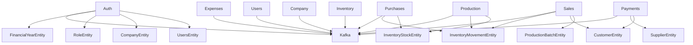

# Current State Architecture Report: B2B Multi-Tenant Manufacturing Management Platform

**Date:** October 2026  
**Architect:** Principal Software Architect  
**Scope:** Comprehensive architectural audit of the existing NestJS backend codebase prior to Modular Monolith restructuring.

---

## 1. Executive Summary

The platform is designed as a multi-tenant B2B Manufacturing and Enterprise Resource Planning (ERP) backend built on **NestJS (v10.3)**, **TypeScript (v5.3)**, **TypeORM (v0.3.20)**, and **PostgreSQL**. It encompasses critical workflows: raw materials and bill of materials (BOM), production planning and batch tracking, inventory control and weighted average costing (WAC), purchases, sales, invoicing, payments, expenses, audit logging, notifications, and analytics reporting.

While the feature coverage and domain modeling reflect real-world manufacturing operations (such as batch tracking, recipe consumption, GST handling, and dual-entry inventory movements), the current implementation operates as an **unstructured monolithic codebase** with significant architectural erosion:
- Feature domains are organized as flat NestJS modules under `src/` without domain/application/infrastructure layers.
- Business logic is heavily coupled directly to TypeORM query runners and database entities.
- Inter-module domain boundaries are repeatedly violated: services bypass other modules and directly mutate foreign entities (e.g., `PurchasesService` and `ProductionService` manipulate `RawMaterialStockEntity` and `InventoryMovementEntity` directly).
- Kafka messaging is invoked directly inside business services immediately after transactions without the Transactional Outbox pattern, leaving the system vulnerable to dual-write inconsistency.
- The `OutboxEventEntity` is defined in `src/common/entities/` but is completely dormant.
- Multi-tenancy relies on manual parameter passing (`companyId`) and a controller guard, creating severe risks of cross-tenant data leaks.
- Request DTOs are almost completely absent; controllers accept `@Body() dto: any` with no input validation.
- File storage and reporting are tightly coupled to local disk and direct raw SQL.

---

## 2. Inventory of Current Modules & Domains

The platform currently consists of **19 feature modules** and **2 infrastructure modules**:

| Module / Folder | Description & Key Responsibilities | Current Layering & State |
| :--- | :--- | :--- |
| `src/auth` | User authentication, JWT issuance, refresh tokens, company initial bootstrap | Controller + Service + Entity. Directly creates Company, Role, User, and FY in `AuthService`. |
| `src/company` | Company settings, Financial Years (FY), and GST tax configurations | Controller + Service + 3 Entities. |
| `src/users` | Users, Roles, and Role-Permissions | Controller + Service + 3 Entities. Missing permission verification guard. |
| `src/materials` | Raw material masters and SKU variants | Controller + Service + 2 Entities + 1 Enum. |
| `src/products` | Finished goods masters and variant SKUs | Controller + Service + 2 Entities + 1 Enum. |
| `src/uom` | Units of Measure (UOM) and conversion factors | Controller + Service + 2 Entities. |
| `src/bom` | Bill of Materials (BOM) definitions and recipe line items | Controller + Service + 2 Entities. |
| `src/inventory` | Raw material stock balances, audit movements, adjustments | Controller + Service + 3 Entities. |
| `src/production` | Production orders, batch output, and raw material consumption | Controller + Service + 3 Entities. Cross-manipulates inventory entities. |
| `src/purchases` | Purchase orders, purchase line items, receiving | Controller + Service + 2 Entities. Cross-manipulates inventory and stock. |
| `src/sales` | Sales orders, sales line items, batch allocations | Controller + Service + 3 Entities. Cross-manipulates production batches, customer balances, and movements. |
| `src/suppliers` | Supplier master data and outstanding balances | Controller + Service + 1 Entity. |
| `src/customers` | Customer master data and receivables balance | Controller + Service + 1 Entity. |
| `src/payments` | Inbound customer payments and outbound supplier payments | Controller + Service + 2 Entities. Directly mutates customer and supplier balances. |
| `src/expenses` | Operational expense records and categories | Controller + Service + 2 Entities. Direct disk uploads. |
| `src/notifications` | User notifications and 90-day retention management | Controller + Service + 1 Entity. |
| `src/audit` | 2-year retention audit logging queries | Controller + Service + 1 Entity. Audit recording method is never called. |
| `src/reports` | Sales, purchase, production, stock, and financial reports | Controller + Service. Direct raw SQL on `DataSource`. |
| `src/dashboard` | KPI aggregation, stock counters, revenue & gross/net profit | Controller + Service. Direct raw SQL on `DataSource`. |
| `src/search` | Full-text global search across 6 business entities | Controller + Service. Direct raw ILIKE SQL queries. |
| `src/kafka` | Kafkajs producer and consumer wrapper | Infrastructure module, currently global. Direct Kafkajs connection. |
| `src/common` | Guards, filters, decorators, and shared entities | Contains `AbstractBaseEntity`, `AttachmentEntity`, `OutboxEventEntity`. |

---

## 3. Critical Architectural Deficiencies

### 3.1 Direct Cross-Module Entity Manipulation (Bypassing Module Encapsulation)
Instead of consuming well-defined Application Services or emitting Domain Events:
- **`ProductionService`**:
  - Directly queries `RawMaterialStockEntity` via `queryRunner.manager`.
  - Directly decrements `usableQuantity` and saves stock.
  - Directly instantiates and saves `InventoryMovementEntity`.
  - Directly updates `ProductionBatchEntity`.
- **`PurchasesService`**:
  - Directly queries and updates `RawMaterialStockEntity` when a purchase is confirmed.
  - Directly recalculates Weighted Average Cost (WAC) for raw materials.
  - Directly records raw material additions into inventory.
- **`SalesService`**:
  - Directly queries `ProductionBatchEntity`, modifies `availableQuantity`, and changes status to `DEPLETED`.
  - Directly queries `CustomerEntity` and increments `outstandingBalance`.
  - On cancellation, directly reverses batch allocations on `ProductionBatchEntity` and reverts `customer.outstandingBalance`.
- **`PaymentsService`**:
  - Directly queries `CustomerEntity` and decrements `outstandingBalance`.
  - Directly queries `SupplierEntity` and decrements `outstandingBalance`.
- **`AuthService`**:
  - Injects repositories for `CompanyEntity`, `UserEntity`, `RoleEntity`, `FinancialYearEntity`, and `RefreshTokenEntity` into a single class, violating domain boundaries.

**Architectural Consequence:** No domain owns its own state. A change to how inventory stock or batch allocation is managed will break Production, Purchases, and Sales simultaneously.

### 3.2 Dual-Write Vulnerability & Lack of Transactional Outbox
In `ProductionService`, `PurchasesService`, `SalesService`, `PaymentsService`, `UsersService`, and `ExpensesService`:
```typescript
await queryRunner.commitTransaction();
await this.kafkaProducer.emit('production.events', 'ProductionConfirmed', { ... });
```
1. **Dual-write hazard:** If the process crashes after `commitTransaction()` and before `emit()`, the database state is persisted but Kafka is never notified. Downstream systems and subscribers will never receive the event.
2. Conversely, if `emit()` fails, it is merely caught with a `logger.warn()` fallback that does not achieve atomicity.
3. While `src/common/entities/outbox-event.entity.ts` exists, it is **never persisted, read, or published**.
4. There is no background Outbox polling worker, no exponential retry, and no Dead Letter Queue routing for outbox events.

### 3.3 Multi-Tenancy Fragility & Tenant Isolation Risks
1. **Reliance on Controller Guards:** Tenant extraction relies on `CompanyTenantGuard` and `@CompanyId()`. If a developer creates a new controller endpoint and forgets `@UseGuards(CompanyTenantGuard)` or `@CompanyId()`, tenant isolation fails completely.
2. **Manual Tenant Parameter Passing:** Every service method must accept `companyId: string`. Service logic manually writes `where: { companyId }`. Missing one `where` clause in an update or delete query can cause cross-tenant data corruption.
3. **No Execution Context / AsyncLocalStorage:** There is no centralized `TenantContext` service to automatically scope database operations or enforce tenant boundaries across async call stacks.
4. **Tenant Identifier Ambiguity:** The codebase uses `companyId` everywhere. The model currently operates with **one company per tenant**. However, database constraints on unique fields (such as SKU, code, email) are occasionally global or unindexed for tenant scoping.

### 3.4 Missing Domain / Application Layering (Anemic Domain Model)
- Controllers directly call Services (`ProductionService`, `SalesService`).
- Services contain HTTP-specific exception throwing (`throw new BadRequestException(...)`), TypeORM transaction management (`QueryRunner`), business validation rules, SQL queries, and Kafka publishing.
- There are no Domain Entities, Value Objects, Domain Events, or Command/Query separation.
- Database entities (`typeorm` entities) are treated as domain models.

### 3.5 Absence of Request DTOs and API Contract Validation
- `ValidationPipe` is registered globally in `main.ts`:
  ```typescript
  new ValidationPipe({ whitelist: true, forbidNonWhitelisted: false, transform: true })
  ```
- However, almost all controller endpoints declare `@Body() dto: any`!
- Because `whitelist: true` only acts on decorated class instances, any request payload passes through without schema validation, type safety, or property sanitization.

### 3.6 Storage Coupling
- `ExpensesController`, `PurchasesController`, and `SalesController` configure `multer.diskStorage` inline with hardcoded paths like `./uploads/expenses`.
- If the application is deployed in a containerized or horizontally scaled environment (Kubernetes / ECS), locally uploaded files will not be shared across replicas and will be lost on container restart.
- There is no storage provider abstraction (`StorageService` interface with `LocalStorageService` and `S3StorageService`).

### 3.7 Inactive / Dead Features
- **Audit Logging:** `AuditService.record()` is implemented with a 2-year retention rule, but **no service or interceptor ever calls it**. User operations generate zero audit logs.
- **Kafka Consumers:** `KafkaConsumerService` connects to Kafka, but no business module defines a topic subscription or handler. Events are emitted into a void.
- **Notifications:** `NotificationsService.createNotification()` is implemented, but no event listener or domain action calls it to notify users when sales are confirmed or stock is depleted.

### 3.8 Raw String & Syntax Errors Discovered
During initial compilation checks (`npx tsc --noEmit`), 5 files failed compilation due to unquoted template strings and non-UTF8 characters:
1. `src/main.ts` (missing template quotes in bootstrap loggers)
2. `src/common/filters/all-exceptions.filter.ts` (unquoted logger statement + raw CP1252 byte)
3. `src/common/filters/http-exception.filter.ts` (unquoted logger statement + raw CP1252 byte)
4. `src/common/messaging/message-consumer-dlq.handler.ts` (unquoted template strings)
5. `src/kafka/kafka-consumer.service.ts` (unquoted log statements)
6. `src/users/entities/role.entity.ts` (contains CP1252 em-dash in entity column comment)

---

## 4. Module Dependency Matrix (As-Is)



Every service currently directly reaches into TypeORM `DataSource` or foreign entities, bypassing domain boundaries.

---

## 5. Architectural Recommendations for Target Modular Monolith

1. **Adopt Tiered Architecture by Domain Complexity:**
   - **Tier 1 (High Complexity):** `bom`, `inventory`, `production`, `purchases`, `sales`, `payments` -> Full Domain, Application, Infrastructure (Persistence), and Presentation separation with explicit Repository interfaces.
   - **Tier 2 (Standard Business):** `company`, `users`, `materials`, `products`, `suppliers`, `customers`, `expenses`, `uom` -> Clean Controller -> Service -> Repository separation with strict DTOs.
   - **Tier 3 (Supporting):** `auth`, `notifications`, `audit`, `reports`, `dashboard`, `search` -> Specialized query/read-model services.

2. **Decouple Cross-Domain State Mutation:**
   - `ProductionService`, `PurchasesService`, and `SalesService` must NOT touch `RawMaterialStockEntity` or `ProductionBatchEntity` directly.
   - Inventory operations must go through an `InventoryService` or `InventoryApplicationService` contract or domain events.
   - Batch allocation must be owned by `Production` or `Inventory`.

3. **Implement Transactional Outbox Pattern:**
   - Move `outbox_events` table under `infrastructure/messaging/outbox/`.
   - In business use cases, save the outbox event within the **same database transaction** as the business mutation.
   - A dedicated `OutboxProcessor` polls `outbox_events` and publishes them to Kafka with exponential backoff and DLQ routing.

4. **Implement Request-Scoped Tenant Context:**
   - Create `TenantContextService` using Node.js `AsyncLocalStorage`.
   - A global `TenantInterceptor` or middleware populates the tenant context upon JWT verification.
   - Repositories or a `TenantAwareRepository` base automatically scope queries with `companyId`.

5. **Storage Abstraction:**
   - Introduce `StorageService` interface in `infrastructure/storage/`.
   - Implement `LocalStorageService` for local dev and `S3StorageService` for production cloud storage.

6. **Full Validation DTOs:**
   - Define strongly typed DTOs with `class-validator` decorators for all endpoints.

---

## 6. Execution Plan

The transformation proceeds in strict sequential phases:
- **Phase 1 (Complete):** Repository audit and Current-State Architecture Report.
- **Phase 2:** Establishing target folder structure under `src/app/`, `src/config/`, `src/common/`, `src/infrastructure/`, and `src/modules/`.
- **Phase 3:** Infrastructure & Common migration (Configs, Tenancy, Outbox, Kafka, Storage, Redis, Observability).
- **Phase 4:** Migrating Tier 2 & Tier 3 domains with DTOs and clean service boundaries.
- **Phase 5:** Migrating Tier 1 core domains (`bom`, `inventory`, `production`, `purchases`, `sales`, `payments`) with domain repository interfaces and clean inter-module boundaries.
- **Phase 6:** Wiring Transactional Outbox and Event Dispatching.
- **Phase 7:** Verification, Compilation, Tests, and Architecture documentation.
